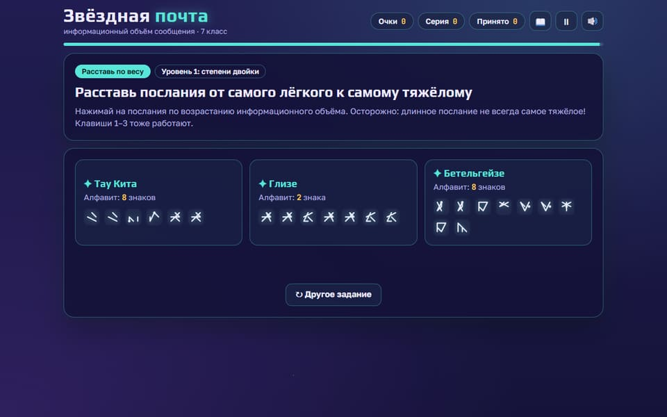
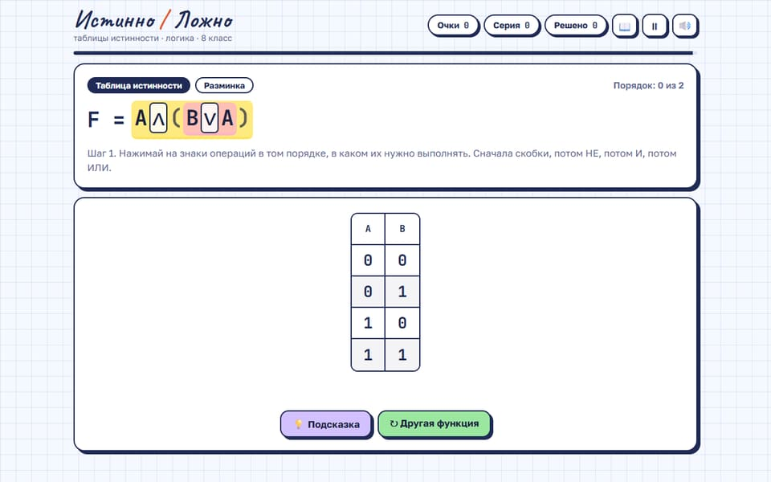

<div align="center">

[](https://infoshag.ru)

# Инфошаг

### Информатика, которую можно попробовать

Авторские игры и тренажёры Антона Кузьмина · 5–11 классы · ОГЭ и ЕГЭ


**[Открыть сайт](https://infoshag.ru) · [Выбрать игру в каталоге](https://infoshag.ru/catalog/)**

[Возможности](#возможности) · [Игры](#игры) · [Запуск](#запуск-на-своём-компьютере) · [Добавить игру](#как-добавить-игру) · [Документация](#с-чего-начать-человеку-или-ии-агенту)

</div>

---

**Инфошаг** — личный сайт учителя информатики с играми и тренажёрами по темам учебника Босовой. Игры открываются в браузере, подходят для компьютера и интерактивной доски, а скачанный HTML-файл можно запускать без интернета. В каталоге также собраны ссылки на авторские курсы и программы.

Проект рассчитан на 5–11 классы и подготовку к ОГЭ и ЕГЭ. Готовые игры сейчас посвящены темам 7–9 классов и доступны бесплатно.

## Возможности

| Ученику | Учителю |
| :--- | :--- |
| 🎯 Тренировка с очками и игровыми заданиями | 🗂 Каталог с поиском и фильтрами по классу и типу материала |
| 💡 Объяснения ошибок и пошаговые разборы | 📝 Контрольные на 10 минут с оценкой в четырёх тренажёрах |
| 🖱 Управление мышью, касанием и клавиатурой | ⬇️ Скачивание игры одним HTML-файлом |
| 🌓 Светлая и тёмная темы | 🔗 Постоянные адреса материалов и запуска игр |

## Игры

<table>
  <tr>
    <td width="50%" align="center">
      <a href="https://infoshag.ru/item/zvezdnaya-pochta/"></a><br>
      <b>Звёздная почта</b><br>7 класс · Измерение информации
    </td>
    <td width="50%" align="center">
      <a href="https://infoshag.ru/item/istinno-lozhno/"></a><br>
      <b>Истинно / Ложно</b><br>8 класс · Алгебра логики
    </td>
  </tr>
</table>

| Игра | Класс | Тема | Контрольная на оценку |
| :--- | :---: | :--- | :---: |
| [🫧 Охота за расширениями](https://infoshag.ru/item/ohota-za-rasshireniyami/) | 7 | Файлы и форматы | — |
| [📡 Звёздная почта](https://infoshag.ru/item/zvezdnaya-pochta/) | 7 | Измерение информации | ✓ |
| [💡 Зажги число](https://infoshag.ru/item/zazhgi-chislo/) | 8 | Перевод между системами счисления | — |
| [⚖️ Числовые весы](https://infoshag.ru/item/chislovye-vesy/) | 8 | Сравнение чисел в разных системах | — |
| [➕ Двоичный столбик](https://infoshag.ru/item/dvoichnyi-stolbik/) | 8 | Арифметика в системах счисления | ✓ |
| [✅ Истинно / Ложно](https://infoshag.ru/item/istinno-lozhno/) | 8 | Таблицы истинности и логические выражения | ✓ |
| [🔎 Поисковые круги](https://infoshag.ru/item/poiskovye-krugi/) | 8–9 | Круги Эйлера и поисковые запросы | ✓ |

В контрольных время идёт по настоящим часам, справка отключена, а результат содержит оценку и разбивку по типам заданий. Параметры учитель может изменить в объекте `EXAM` внутри файла игры.

## Технологии

| Часть проекта | Решение |
| :--- | :--- |
| Сайт | Astro 7 · TypeScript · статическая сборка |
| Материалы | Markdown с frontmatter · коллекция `items` |
| Игры | Самодостаточные HTML-файлы: CSS и JavaScript внутри |
| Превью | Кадры из игр, светлая и тёмная версии, изображения для соцсетей |
| Публикация | GitHub Actions → GitHub Pages · домен infoshag.ru |

Сейчас сайт работает без сервера, базы данных и регистрации. Лента постов с роликами, подписка и игра «Клевер» запланированы — текущее состояние отмечено в [плане работ](docs/ROADMAP.md).

## С чего начать (человеку или ИИ-агенту)

| Файл | Зачем читать |
|---|---|
| [`AGENTS.md`](AGENTS.md) | правила проекта: стек, структура, стандарт игр, что нельзя делать без автора |
| [`docs/STRATEGY.md`](docs/STRATEGY.md) | что мы строим и почему: ВК + сайт, бесплатно сейчас, подписка потом |
| [`docs/ROADMAP.md`](docs/ROADMAP.md) | план работ по этапам с текущим статусом — **отсюда брать следующую задачу** |
| [`docs/SITE.md`](docs/SITE.md) | устройство сайта: стена с роликами, адреса, модель доступа под будущую подписку |
| [`docs/GAMES.md`](docs/GAMES.md) | все игры: что готово, что улучшить, банк идей |
| [`docs/VK.md`](docs/VK.md) | группа во ВКонтакте: структура, посты, клипы |
| [`docs/klever/`](docs/klever/) | большая игра «Клевер» (исполнитель Робот): мир, план, готовые запросы для Claude Code |

## Запуск на своём компьютере

Нужен Node.js 22 или новее.

```bash
npm install
npm run dev      # http://localhost:4321/
npm run build    # проверка сборки — должна проходить без ошибок
npm run preview  # просмотр собранного сайта
```

## Как добавить игру

1. Положите файл в `public/games/<slug>.html` (slug — латиница через дефис).
2. Создайте карточку `src/content/items/<slug>.md` — шаблон и все поля описаны в `AGENTS.md`, раздел 4.
3. Снимите превью командой `npm run posters <slug>` и укажите `poster` в карточке.
4. Проверьте игру по стандарту из `AGENTS.md`, запустите `npm run build` и откройте результат через `npm run preview`.
5. После коммита и `git push` сайт пересоберётся сам.

Для публикаций используйте постоянные адреса `/item/<slug>/` и `/igra/<slug>/`. После публикации slug не меняется. В коде сайта внутренние ссылки строятся через `BASE_URL` или функции из `src/lib.ts`.

## Публикация

GitHub Actions (`.github/workflows/deploy.yml`) собирает и публикует сайт после каждого push в `main`.
Один раз нужно включить: **Settings → Pages → Source: GitHub Actions**.

Свой домен: в `astro.config.mjs` поставить `site: 'https://ваш-домен.ru'` и `base: '/'`
(или задать переменные окружения `SITE_URL` и `BASE`).

## Структура

```
AGENTS.md, CLAUDE.md      правила для ИИ-агентов
docs/                    стратегия, план, описание сайта, игр, ВК, «Клевера»
src/config.ts            название сайта, автор, ссылки
src/content.config.ts    поля карточки материала
src/content/items/       карточки материалов (по одной на файл)
src/pages/               главная, каталог, страница материала
public/games/            сами игры — самодостаточные HTML-файлы
public/posts/            кадры из игр и ролики
scripts/                 подготовка превью
```
